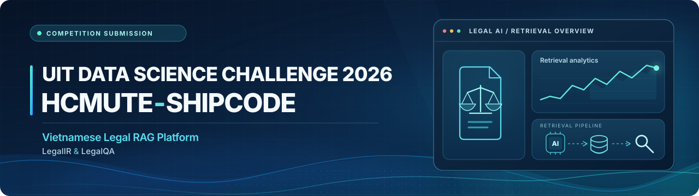
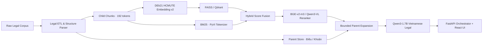

<div align="center">
  


  <p>
    
    
    
    
    
    
  </p>

  <p><strong>Hệ thống RAG Pháp luật Tiếng Việt end-to-end: Legal ETL theo cấu trúc điều-khoản, Hybrid Retrieval, Cross-Encoder Reranking và Hỏi đáp có trích dẫn chuẩn xác.</strong></p>

  <p>
    <a href="#tổng-quan--bài-toán">Tổng quan</a> ·
    <a href="#kiến-trúc-hệ-thống">Kiến trúc</a> ·
    <a href="#phân-công-thành-viên">Thành viên</a> ·
    <a href="#cài-đặt--chạy-local">Cài đặt</a> ·
    <a href="#hướng-dẫn-sử-dụng-usage">Hướng dẫn chạy</a> ·
    <a href="#cấu-trúc-repository">Cấu trúc repo</a> ·
    <a href="#kiểm-thử--chất-lượng">Kiểm thử</a>
  </p>
</div>

---

## Mục lục

- [Tổng quan & Bài toán](#tổng-quan--bài-toán)
- [Kiến trúc hệ thống](#kiến-trúc-hệ-thống)
- [Dữ liệu & Mô hình chính thức](#dữ-liệu--mô-hình-chính-thức)
- [Phân công thành viên](#phân-công-thành-viên)
- [Cài đặt & Chạy local](#cài-đặt--chạy-local)
- [Hướng dẫn sử dụng (Usage)](#hướng-dẫn-sử-dụng-usage)
- [Hợp đồng API](#hợp-đồng-api)
- [Kiểm thử & Chất lượng](#kiểm-thử--chất-lượng)
- [Cấu trúc repository](#cấu-trúc-repository)
- [Giấy phép](#giấy-phép)

---

## Tổng quan & Bài toán

**HCMUTE-SHIPCODE — UDSC 2026** là hệ thống Retrieval-Augmented Generation (RAG) chuyên biệt cho văn bản quy phạm pháp luật tiếng Việt, xây dựng cho **UIT Data Science Challenge 2026**. Dự án giải quyết trọn vẹn hai bài toán cốt lõi trên cùng một nền tảng dữ liệu và mô hình mã nguồn mở cục bộ (`< 4B` tham số, không gọi API thương mại):

- **Task 1 — LegalIR (Truy hồi văn bản pháp luật):** Truy hồi danh sách `document_id` liên quan nhất với câu hỏi pháp lý, hỗ trợ truy vấn đa văn bản (multi-gold) và đánh giá bằng **Macro Recall**, **Macro Precision** và **F1**.
- **Task 2 — LegalQA (Hỏi đáp pháp luật có trích dẫn):** Sinh câu trả lời dựa trên ngữ cảnh pháp lý đã truy hồi và kiểm chứng trích dẫn (*Điều / Khoản / Điểm*), đánh giá bằng **METEOR**, **ROUGE-L** và kiểm tra chống suy diễn (anti-hallucination).

---

## Kiến trúc hệ thống

Hệ thống tuân thủ nghiêm ngặt luồng xử lý đa tầng: **`retrieve children → rerank → bounded parent expansion → local LLM`**, bảo toàn đầy đủ metadata trích dẫn qua toàn bộ pipeline.



### Các tầng kỹ thuật chính

1. **Legal ETL & Parent–Child Chunking (`src/udsc2026/ingestion/`):** Đọc đa định dạng nguồn (`JSON`, `JSONL`, `PDF`, `DOCX`, `TXT`), chuẩn hóa Unicode tiếng Việt, phân tích phân cấp pháp lý (`Luật → Chương → Mục → Điều → Khoản → Điểm`) với cơ chế fallback an toàn khi văn bản thiếu cấu trúc chuẩn. Tách riêng **Child chunks** (ngắn, tối ưu độ chính xác retrieval) và **Parent contexts** (đầy đủ điều khoản để LLM hiểu trọn vẹn ngữ cảnh).
2. **Hybrid Dense + Sparse Retrieval (`src/udsc2026/retrieval/`):** Kết hợp **Dense Retrieval** (embedding `DEk21_hcmute_embedding_v2`, hỗ trợ cả `Qdrant` cho production và `FAISS` cho chạy nhanh local/GPU) với **Sparse BM25** (tách từ tiếng Việt bằng `pyvi`, giữ nguyên ký hiệu điều/khoản).
3. **Cross-Encoder Reranking & Fine-Tuning (`src/udsc2026/retrieval/reranking/`, `src/udsc2026/training/`):** Tái xếp hạng top-K ứng viên bằng `BAAI/bge-reranker-v2-m3` (fine-tuned với hard-negative mining & conflict-anchor loss) hoặc `Qwen/Qwen3-VL-Reranker-2B` ở cấp độ chunk/document.
4. **Grounded QA & Citation Verification (`src/udsc2026/qa/`):** `ParentContextExpander` mở rộng ngữ cảnh trong ngân sách token giới hạn (`max_parent_tokens: 2048`, `max_total_tokens: 7000`), nạp prompt template có version từ `prompts/`, gọi **Local LLM** (`Qwen3-1.7B-Vietnamese-Legal-GRPO`), và kiểm chứng citation đầu ra qua `CitationParser` đối chiếu với chunk nguồn.
5. **FastAPI Orchestration & Web UI (`src/udsc2026/api/`, `frontend/`):** `RAGOrchestrator` điều phối toàn bộ luồng bất đồng bộ kèm Redis cache (fallback in-memory), đo latency từng stage và phục vụ giao diện demo **React 19 + TypeScript + Vite**.

---

## Dữ liệu & Mô hình chính thức

### Corpus `data/processed_v3`

| Hạng mục | Giá trị đã kiểm định |
| --- | ---: |
| Số văn bản pháp luật (Documents) | **8.532** |
| Số đoạn con (Child chunks) | **1.270.356** |
| Số ngữ cảnh cha (Parent stores) | **184.548** |
| Synthetic benchmark nội bộ | **100 câu hỏi**, 7 nhóm cấu trúc |
| Missing / Duplicate / Orphan / Empty chunk | **0** |

### Danh mục mô hình (`< 4B` tham số, Local Open-Weights)

| Vai trò | Checkpoint HuggingFace | Tham số | Local Path | Công dụng |
| --- | --- | ---: | --- | --- |
| **Embedding** | [`huyydangg/DEk21_hcmute_embedding_v2`](https://huggingface.co/huyydangg/DEk21_hcmute_embedding_v2) | ~135M | `models/dek21-v2` | Vector hóa query và child chunk (768-d, cosine) |
| **Reranker (Task 1)** | [`BAAI/bge-reranker-v2-m3`](https://huggingface.co/BAAI/bge-reranker-v2-m3) | ~568M | `models/reranker` | Cross-encoder chấm điểm & fine-tune xếp hạng LegalIR |
| **Reranker (VL/Doc)** | [`Qwen/Qwen3-VL-Reranker-2B`](https://huggingface.co/Qwen/Qwen3-VL-Reranker-2B) | ~2.0B | `models/qwen3-vl-reranker-2b` | Reranking đa phương thức / tài liệu dài |
| **Generator (LLM)** | [`thangvip/qwen3-1.7b-vietnamese-legal-grpo-phase-2`](https://huggingface.co/thangvip/qwen3-1.7b-vietnamese-legal-grpo-phase-2) | 1.7B | `models/qwen3-legal` | Sinh câu trả lời pháp luật kèm trích dẫn chuẩn |

Xem chi tiết tại [Model Registry](docs/models/model_registry.md).

---

## Phân công thành viên

Dự án được tổ chức theo 5 vai trò chuyên môn (chi tiết kiến trúc và quy ước nằm trong `docs/`):

| Thành viên | Vai trò chính | Phạm vi phụ trách trong mã nguồn |
| --- | --- | --- |
| **Hoàng Long** | Integration & Orchestration | `src/udsc2026/api/`, `contracts/`, `RAGOrchestrator`, Redis cache, health/readiness probes |
| **Trung Nghĩa** | Retrieval Specialist | `src/udsc2026/retrieval/{dense,sparse,hybrid}/`, `infrastructure/{embedding,vector_db}/` (Qdrant, FAISS, BM25) |
| **Thế Quân** | QA & Local LLM Specialist | `src/udsc2026/qa/`, `infrastructure/llm/`, `prompts/`, chống hallucination & kiểm chứng citation |
| **Trung Khang** | Data Engineering & Synthetic Benchmark | `src/udsc2026/ingestion/`, structure parser, parent–child chunking, corpus audit (`processed_v3`) |
| **Nguyên Khang** | Reranking, Evaluation, MLOps & Web UI | `src/udsc2026/retrieval/reranking/`, `evaluation/`, `docker/`, `frontend/` (React/Vite UI) |

---

## Cài đặt & Chạy local

### Yêu cầu môi trường
- **Python**: `3.10 – 3.12` (khuyến nghị **Python 3.11**)
- **Node.js**: `^20.19.0` hoặc `>=22.12.0` (cho Web UI)
- **Docker & Docker Compose** (tùy chọn, để chạy Qdrant + Redis + Backend đóng gói)

### 1. Cài đặt Python environment

```powershell
git clone https://github.com/solvarhuynh/UIT-Data-Science-Challenge-2026.git
cd UIT-Data-Science-Challenge-2026

py -3.11 -m venv .venv
.\.venv\Scripts\Activate.ps1

python -m pip install --upgrade pip
python -m pip install -c requirements_runtime.txt -e ".[llm,rerank,retrieval,models]"
python -m pip install -r requirements_dev.txt
```

### 2. Cấu hình & Tải mô hình local

```powershell
Copy-Item .env.example .env
python download_models.py --profile all
```

*(Tùy chọn chỉ tải model cho Task 1: `python download_models.py --profile task1`)*

### 3. Khởi chạy Backend & Frontend

**Cách A — Chạy bằng Docker Compose (Backend + Qdrant + Redis):**

```powershell
docker compose up -d --build
```

**Cách B — Chạy trực tiếp trên máy local:**

```powershell
# Terminal 1: Khởi chạy Qdrant & Redis (hoặc dùng FAISS local)
docker compose up -d qdrant redis

# Terminal 2: Chạy FastAPI Backend
make run-backend
# hoặc: uvicorn udsc2026.api.app:app --reload --host 127.0.0.1 --port 8000

# Terminal 3: Chạy React Frontend
cd frontend
npm ci
npm run dev
```

---

## Hướng dẫn sử dụng (Usage)

### 1. Xử lý dữ liệu & Đánh chỉ mục (Data Prep & Indexing)

```powershell
# Chạy ETL & tách parent-child chunks
python scripts/data_prep/run_ingestion.py --input-dir data/raw --output-dir data/processed_v3

# Đánh chỉ mục Dense Vector (FAISS hoặc Qdrant) & Sparse BM25
python scripts/data_prep/index_chunks.py --chunks-dir data/processed_v3/chunks --config-env gpu --vector-db-type faiss --force
python scripts/data_prep/build_bm25.py --chunks-dir data/processed_v3/chunks --output data/vector_store/bm25/index.json
```

### 2. Huấn luyện / Fine-tune (Training)

```powershell
# Task 1: Hard-negative mining & Fine-tune BGE-Reranker-v2-m3
python scripts/training/mine_task1_negatives.py
python scripts/training/finetune_task1_bge_reranker_v3.py

# Task 2: Fine-tune Qwen LoRA / Parent Cross-Encoder / Answer Selector
python scripts/training/finetune_task2_qwen_lora.py
python scripts/training/train_legal_qa_parent_crossencoder.py
```

### 3. Suy luận & Đánh giá (Inference & Evaluation)

```powershell
# Sinh candidate & Benchmark Reranker
python scripts/evaluation/generate_dense_candidates.py `
  --benchmark data/processed_v3/benchmarks/synthetic_qa.jsonl `
  --config-env gpu `
  --candidate-k 50 `
  --output artifacts/dense_predictions.jsonl

python scripts/evaluation/benchmark_reranker.py `
  --benchmark data/processed_v3/benchmarks/synthetic_qa.jsonl `
  --candidates artifacts/dense_predictions.jsonl `
  --model models/qwen3-vl-reranker-2b `
  --top-n 5

# Đánh giá chuẩn LegalIR (Task 1) và LegalQA (Task 2)
python scripts/evaluation/evaluate_legal_ir.py --help
python scripts/evaluation/evaluate_legal_qa.py --help

# Chạy pipeline Task 1 end-to-end hoặc sinh câu trả lời Task 2
python scripts/inference/run_legal_ir.py --help
python scripts/inference/generate_legal_qa_answers.py --help
```

---

## Hợp đồng API

Backend FastAPI cung cấp các endpoint chuẩn hóa tại `http://127.0.0.1:8000`:

| Method | Endpoint | Mô tả |
| :--- | :--- | :--- |
| `GET` | `/health` | Kiểm tra tiến trình FastAPI đang hoạt động |
| `GET` | `/ready` | Kiểm tra trạng thái sẵn sàng của model, VectorDB (Qdrant/FAISS) và Redis |
| `POST` | `/api/v1/query` | Truy vấn RAG end-to-end: trả về câu trả lời kèm danh sách `citations` và thời gian từng stage |

---

## Kiểm thử & Chất lượng

Repository đi kèm bộ test tự động (`unit`, `integration`, `retrieval`) và pipeline kiểm tra chất lượng tĩnh (`ruff`, `mypy`, `pydocstyle`, `bandit`):

```powershell
# Chạy toàn bộ unit & integration tests (không cần GPU/model weights)
python -m pytest -v --basetemp .pytest_runtime -p no:cacheprovider

# Chạy offline smoke check cho toàn bộ cấu hình & contracts
python scripts/ci_cd/smoke_test.py --mode host

# Chạy kiểm tra chất lượng mã nguồn (Lint, Typecheck, Docstyle, Security)
python scripts/ci_cd/quality_gate.py
```

---

## Cấu trúc repository

```text
.
├── configs/                         # Cấu hình YAML (base, development, gpu, task1_baseline, task1_top1)
├── docker/
│   ├── backend.Dockerfile           # Multi-stage Dockerfile cho FastAPI backend
│   └── frontend.Dockerfile          # Dockerfile cho React/Vite frontend
├── docs/
│   ├── algorithms/                  # Ghi chú thuật toán retrieval & chunking
│   ├── architecture/                # Thiết kế ETL pipeline & FastAPI guidelines
│   ├── assets/                      # Banner SVG cho tài liệu
│   ├── models/                      # Model registry & tối ưu LLM
│   └── project/                     # System design, API contract, coding convention
├── frontend/                        # Ứng dụng Web demo (React 19 + TypeScript + Vite)
├── prompts/                         # System prompts & RAG templates có quản lý version
├── scripts/
│   ├── ci_cd/                       # Smoke test, quality gate & CI script
│   ├── data_prep/                   # ETL ingestion, chunk repair, FAISS/Qdrant/BM25 indexing
│   ├── evaluation/                  # Đánh giá LegalIR, LegalQA, benchmark reranker, tuning
│   ├── gpu/                         # GPU preflight & runner
│   ├── inference/                   # Pipeline suy luận, ensemble & kiểm định submission
│   └── training/                    # Fine-tune BGE Reranker (Task 1), Qwen LoRA / DPO / Selector (Task 2)
├── src/
│   └── udsc2026/
│       ├── api/                     # FastAPI app, Redis/in-memory cache, RAGOrchestrator
│       ├── contracts/               # Pydantic schemas (API, chunk, health, QA, retrieval)
│       ├── evaluation/              # Metrics & evaluator cho LegalIR & LegalQA
│       ├── infrastructure/          # Embedding, LLM, Reranker clients & Qdrant/FAISS adapters
│       ├── ingestion/               # Readers, cleaners, legal structure parser & chunker
│       ├── qa/                      # PromptBuilder, QAEngine & CitationParser
│       ├── retrieval/               # Dense, Sparse (BM25), Hybrid fusion, Reranking & ParentContext
│       └── training/                # Core training utilities (Task 1 chunk training v3)
├── tests/
│   ├── fixtures/                    # Mock corpus & fixtures cho kiểm thử offline
│   ├── integration/                 # Kiểm thử luồng ingestion & API
│   ├── retrieval/                   # Kiểm thử BM25, Dense & Hybrid retriever
│   └── unit/                        # Unit tests cho config, contracts, QA, reranking & evaluation
├── .env.example                     # Mẫu biến môi trường runtime
├── .gitignore
├── docker-compose.yml               # Orchestration: Backend + Qdrant + Redis
├── download_models.py               # Script tải model HuggingFace kèm resolved SHA manifest
├── LICENSE
├── Makefile                         # Các lệnh chuẩn hóa (install, test, lint, run-backend, run-frontend)
├── pyproject.toml                   # Package metadata, dependencies & tool configs
└── README.md
```

