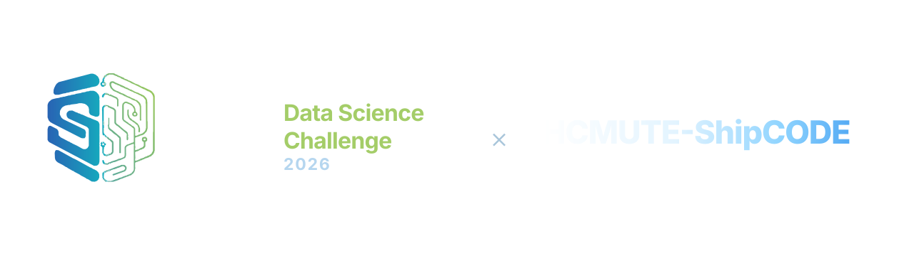
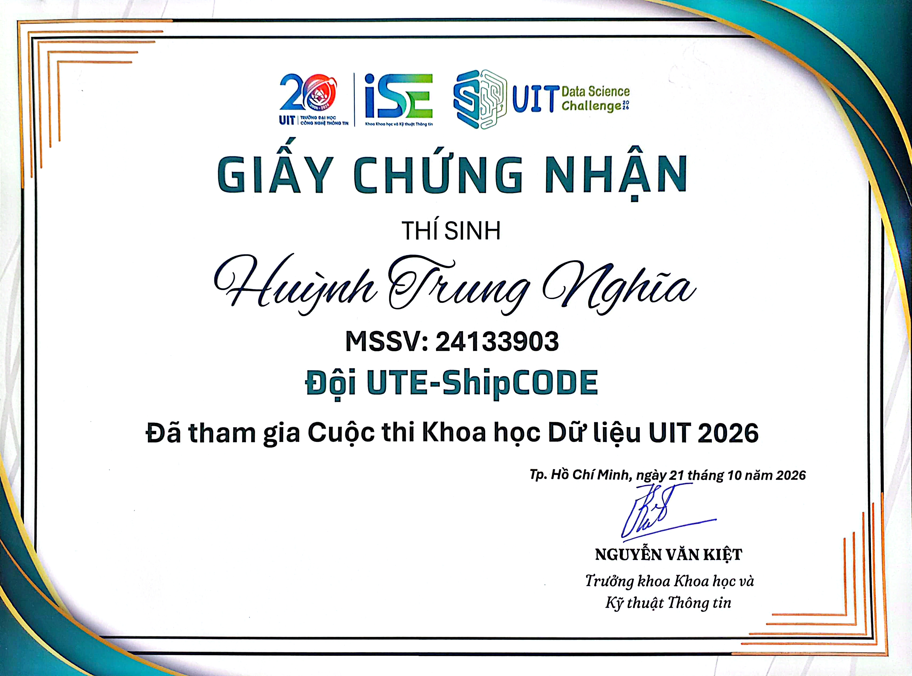

<div align="center">
  
  <h1>HCMUTE-ShipCODE · UDSC 2026</h1>
  <p><strong>Hệ thống truy hồi và hỏi đáp có căn cứ trên văn bản pháp luật tiếng Việt</strong></p>
  <p>
    
    
    
  </p>
</div>

> Kết quả cuối cuộc thi: Đội ShipCODE đạt **Top 10** cuộc thi UDSC 2026
- **Task 1: 0.954**
- **Task 2 : 0.652**

---
## Tóm tắt

Bài viết mô tả hệ thống HCMUTE-ShipCODE cho hai tác vụ xử lý câu hỏi pháp luật tiếng Việt tại UIT Data Science Challenge 2026: truy hồi văn bản pháp luật (LegalIR) và sinh câu trả lời dựa trên bằng chứng truy hồi (LegalQA). Hệ thống kết hợp phân đoạn có nhận biết cấu trúc pháp lý, truy hồi dense và lexical, hợp nhất thứ hạng, cross-encoder reranking và sinh câu trả lời có kiểm soát ngữ cảnh. Đội báo cáo kết quả cuối cuộc thi **0.954 ở Task 1**, **0.652 ở Task 2** và thành tích **Top 10**. README trình bày kết quả cuộc thi tách biệt với các benchmark phát triển nội bộ; không suy diễn điểm leaderboard từ OOF hoặc các thí nghiệm của đội khác.

**Từ khóa:** truy hồi thông tin pháp luật, RAG, tiếng Việt, hard negatives, reranking, sinh câu trả lời có căn cứ.

## 1. Bài toán và mục tiêu nghiên cứu

LegalIR nhận câu hỏi tiếng Việt và trả về tối đa năm mã văn bản liên quan. LegalQA nhận câu hỏi và sinh câu trả lời dựa trên ngữ cảnh pháp luật đã chọn. Hai tác vụ có liên hệ nhưng tối ưu các khâu khác nhau: LegalIR cần giữ gold trong candidate set rồi đặt chúng ở thứ hạng cao; LegalQA cần truy xuất đúng evidence và tạo văn bản có độ phủ nội dung phù hợp với scorer.

Các câu hỏi thiết kế xuyên suốt dự án là:

1. Làm thế nào giữ được thông tin điều, khoản và điểm của văn bản trong khi vẫn tạo đơn vị truy hồi đủ gọn?
2. Kết hợp truy hồi ngữ nghĩa với khớp từ khóa ra sao để xử lý cả câu hỏi diễn đạt tự nhiên lẫn số hiệu pháp luật?
3. Reranking có thể cải thiện thứ tự trên một candidate pool cố định tới đâu?
4. Với LegalQA, làm sao truyền evidence đủ rộng cho mô hình mà không để câu trả lời trôi khỏi nguồn?

## 2. Dữ liệu và tiền xử lý

Corpus cuộc thi gồm **8.532 văn bản**. Pipeline của repo chuyển corpus thành **1.270.356 chunks** và **184.548 parent contexts**. Parser giữ metadata cấu trúc pháp lý; mỗi chunk phục vụ tìm kiếm cục bộ trong khi parent context cho phép mở rộng nội dung trước khi sinh câu trả lời.

Embedding được tạo bằng `AITeamVN/Vietnamese_Embedding_v2` (đầu ra 1.024 chiều; độ dài truy vấn tối đa 256 token và tài liệu 2.048 token theo cấu hình). Index FAISS gắn với fingerprint và manifest để xác nhận đầu vào trước khi inference. Dữ liệu train có nhãn dùng cho huấn luyện hoặc chấm/diagnostic theo đúng stage; public/private không được dùng để fit hay chọn tham số.

## 3. Phương pháp

### 3.1. LegalIR: candidate generation và ranking

Pipeline thực hiện truy hồi dense trên index FAISS, bổ sung tín hiệu lexical BM25, hợp nhất thứ hạng bằng RRF và dùng `AITeamVN/Vietnamese_Reranker` để chấm lại ứng viên. Runner vận hành cho phép cấu hình candidate depth và số ứng viên rerank; đầu ra cuối cùng được tổng hợp về document ID theo schema LegalIR, tối đa năm văn bản mỗi câu.

Thiết kế này tách hai nguồn lỗi: **candidate miss** (văn bản đúng không nằm trong pool) và **ranking miss** (văn bản đúng có trong pool nhưng bị xếp dưới top 5). Phân biệt này quan trọng vì reranker không thể phục hồi tài liệu chưa được truy hồi. Các báo cáo đánh giá nên ghi candidate coverage bên cạnh metric cuối.

### 3.2. LegalQA: truy xuất evidence và sinh câu trả lời

Với mỗi câu hỏi, pipeline truy hồi passages, rerank chúng, rồi lấy parent context để bổ sung ngữ cảnh pháp lý. `Qwen/Qwen3.5-2B` sinh câu trả lời theo prompt lưu trong repo. Câu trả lời được kiểm tra theo contract và đóng gói thành submission BTC. Scorer dùng METEOR và ROUGE-L; METEOR là chỉ số xếp hạng trọng tâm theo đặc tả cuộc thi, vì vậy câu trả lời cần phủ nội dung tham chiếu chứ không chỉ ngắn gọn hoặc trôi chảy.

### 3.3. Huấn luyện và hard-negative mining

Trong IR, Mẫu này giúp cross-encoder học phân biệt các điều khoản gần chủ đề, số hiệu hoặc cách diễn đạt. Repo hiện có các CLI chuẩn bị nhóm chunk, mine hard/semi-hard negatives theo fold và một entrypoint fine-tune reranker có cổng cho phép rõ ràng. Việc có mã huấn luyện không tự chứng minh checkpoint đó đã được dùng để tạo submission cuối.

Vì vậy, kết quả cuộc thi trong README được gắn với **cấu hình mô hình đã chọn** gồm AITeam Vietnamese Embedding, AITeam Vietnamese Reranker và Qwen3.5-2B; README không khẳng định một checkpoint fine-tune riêng đã tạo ra các điểm 0.954/0.652 nếu thiếu manifest/checkpoint và provenance của lần nộp để xác nhận. Đây là ranh giới cần thiết giữa mô tả phương pháp có trong mã nguồn và lịch sử tạo submission.

### 4.1. Candidate coverage trước khi tăng độ phức tạp

Endgame-Top7 trình bày đo oracle/candidate Recall@K trước reranking và tách miss của candidate generation khỏi lỗi thứ hạng. Team Artiz và UIT-Trust-Companion kết hợp nhiều kênh (BM25, dense, heading/document view) trước cross-encoder. Bài học áp dụng cho nghiên cứu LegalIR là đánh giá từng nguồn và union trên cùng câu hỏi, rồi chỉ tăng tầng ranking khi candidate pool có coverage đủ cao.

### 4.2. Fine-tuning và hard negatives

Team Artiz, Kietnehi, UIT-Kitchen và UIT-Trust-Companion mô tả các biến thể fine-tune bi-encoder hoặc reranker bằng các cặp dương/âm, trong đó hard negatives lấy từ kết quả truy hồi gần đúng. Những thí nghiệm này cho thấy đây là hướng nghiên cứu có cơ sở cho miền pháp luật: các điều khoản cùng chủ đề dễ gây nhầm lẫn hơn negative ngẫu nhiên. Tuy nhiên, tạo negative từ gold toàn bộ dữ liệu có thể rò thông tin qua folds; mining phải fold-isolated, loại trừ positives và giữ đúng phân phối candidate ở inference.

Trong repo hiện tại đã có công cụ mining và chuẩn bị dữ liệu huấn luyện an toàn theo fold. README xem fine-tuning là một thành phần nghiên cứu/khả năng của pipeline; chỉ gọi là thành phần của submission khi có checkpoint và manifest khớp với lần nộp.

### 4.3. Xếp hạng cấp tài liệu

Các lời giải Team Artiz, UIT-Kitchen và Kietnehi khảo sát cách tổng hợp nhiều chunk thành điểm document, feature evidence/MIL hoặc learning-to-rank như LambdaRank. Điều này giải quyết độ lệch giữa đơn vị tìm kiếm (chunk) và đơn vị dự thi (document ID). Khi áp dụng, feature phải được tạo OOF hoặc trong fold tương ứng; query memory, document frequency và co-occurrence từ nhãn có nguy cơ leakage.

### 4.4. LegalQA: evidence-first và tối ưu metric

GhienAram báo cáo rằng truy hồi theo chunk 256 từ tăng R@5 trên tập weak-gold 224 câu so với index toàn văn bản (42,0% lên 83,0% trong báo cáo của họ). Repo mô tả BM25+dense/RRF, reranker fine-tune, mở rộng evidence tới Điều, Qwen3.5-2B LoRA và chọn giữa nhiều câu trả lời bằng Minimum Bayes Risk theo METEOR. Kietnehi cũng khảo sát extraction-first/quote-first, còn poster UIT-Kitchen nhấn mạnh retrieval → quote → complete. Đây là bằng chứng tham khảo cho chiến lược ưu tiên truy xuất và phủ evidence trước khi thêm tầng sinh phức tạp; các số nêu trên thuộc benchmark của đội đó, không phải kết quả tái lập trên dữ liệu của chúng tôi.

### 4.5. Những hướng không được xem là kết quả của đội

Các kỹ thuật như nhiều embedding/reranker, LambdaMART, query-neighbor memory, exact-query overlay, MBR nhiều candidate, LoRA generator và citation graph xuất hiện trong repo/poster tham khảo. Chúng giúp hình thành giả thuyết nghiên cứu, nhưng không được gán cho pipeline HCMUTE-ShipCODE nếu không có cấu hình, artifact và lần chạy tương ứng. Poster/README bên ngoài cũng không thay thế benchmark cùng IDs, grouped folds và scorer BTC.

<p align="center"></p>
## 5. Kết quả

| Tác vụ | Metric/đầu ra | Kết quả cuộc thi |
|---|---|---:|
| LegalIR | Điểm Task 1 theo kết quả cuộc thi | **0.954** |
| LegalQA | Điểm Task 2 theo kết quả cuộc thi | **0.652** |
| Tổng thứ hạng | UIT Data Science Challenge 2026 | **Top 10** |

Giấy khen: [`assets/certificate/02-trungnghia.jpg`](assets/certificate/02-trungnghia.jpg). Các số này là kết quả cuối cuộc thi được nhóm cung cấp; không diễn giải chúng thành Recall@5, METEOR, OOF hay public score nếu thiếu bảng kết quả BTC/biên bản chỉ rõ metric. Trong đánh giá nghiên cứu nội bộ, LegalIR cần báo macro metric, từng fold, candidate coverage và paired grouped bootstrap; LegalQA cần báo METEOR và ROUGE-L riêng theo scorer BTC.

## 6. Tái lập

### Môi trường

Yêu cầu Python 3.12; dữ liệu và trọng số được quản lý ngoài Git. GPU chạy qua Modal, ưu tiên A10 và L4 dự phòng.

```powershell
py -3.12 -m venv .venv
.\.venv\Scripts\Activate.ps1
python -m pip install --upgrade pip
python -m pip install -e ".[answers,data,modal,models]"
python scripts/shared/download_models.py --profile all
```

### Index và inference

Xác minh manifest index trước khi sinh candidates.

```powershell
python -m modal run --detach scripts/data_prep/run_modal_index.py --batch-size 16 --checkpoint-chunks 100000
python -m modal run scripts/retrieval/inference/run_modal.py --dataset train --candidate-k 500 --rerank-k 200
python -m modal run scripts/retrieval/inference/run_modal.py --dataset public --candidate-k 500 --rerank-k 200
python -m modal run scripts/answers/inference/run_modal.py --dataset train --limit 500 --candidate-k 500 --rerank-k 200 --save-every 100
python -m modal run scripts/answers/inference/run_modal.py --dataset public --save-every 100
```

Các lệnh train/public có mục đích khác nhau. Public chỉ dùng để tạo submission, không fit hoặc chọn cấu hình. Với nghiên cứu so sánh, dùng cùng IDs/candidate pool/scorer và grouped folds; ghi hashes, model/config, checkpoint, batch, thời gian và điều kiện dừng.

### Fine-tune reranker theo fold

Mount volume `udsc` với model AITeam reranker, manifest tải model, `data/splits/retrieval/folds.json` và bộ `groups.jsonl`, `manifest.json` trong `data/training/retrieval/`. Đặt `dense.jsonl`, `questions.json`, `dense.manifest.json` và `reranked.manifest.json` trong `data/predictions/selected/legalir/train/candidate_k500_rerank_k200/`.

```powershell
python -m modal run scripts/retrieval/inference/run_modal.py::train_fold --fold 0 --loss softmax
python -m modal run scripts/retrieval/inference/run_modal.py::train_fold --fold 0 --loss bce
```

Mỗi lệnh huấn luyện trên phần train của fold và ghi reranking cho phần held-out vào `data/predictions/selected/legalir/folds/<loss>/fold_<fold>/`. Dùng `--resume` khi tiếp tục cùng cấu hình. Chỉ tổng hợp OOF sau khi đủ năm fold cho cùng loss.

## 7. Hạn chế và tính hợp lệ

- Điểm leaderboard là kết quả cuộc thi của đội; không đủ dữ liệu trong README để tái dựng toàn bộ phép chấm thành một benchmark nội bộ.
- Corpus có 20 source passages rỗng; sáu tài liệu trong số đó là gold của chín câu LegalIR. Các trường hợp này giới hạn candidate coverage và cần được giữ trong diễn giải kết quả.
- Kết quả các đội khác nhau về split, population, scorer và loại điểm (OOF, public, private, một fold); không so như ablation cùng điều kiện.
- Những kỹ thuật dùng label-derived memory hoặc feature phải được cô lập theo fold. Public/private không được dùng để fit/tune.


## Cấu trúc repository

```text
src/udsc2026/
├── ingestion/          # Đọc, chuẩn hóa, parse cấu trúc và chia đoạn văn bản
├── retrieval/          # Dense/sparse retrieval, fusion, context và reranking
├── answer_generation/  # Prompt và sinh câu trả lời có trích dẫn
├── evaluation/         # Scorer, diagnostics và hợp đồng submission
└── infrastructure/     # Model clients, cấu hình và vector store
scripts/
├── data_prep/          # Chuẩn bị dữ liệu và dựng index
├── retrieval/          # Inference, đánh giá và đóng gói LegalIR
├── answers/            # Sinh, chấm và đóng gói LegalQA
└── shared/             # Công cụ vận hành dùng chung
configs/                # Cấu hình pipeline
prompts/                # Prompt cho answer generation
data/                   # Dữ liệu, index và predictions (ngoài Git)
models/                 # Trọng số mô hình (ngoài Git)
assets/                 # Banner, logo và giấy khen
docs/comparisons/       # Báo cáo đối chiếu các lời giải tham khảo
```
## 9. Nhóm thực hiện

| Thành viên | Phạm vi |
|---|---|
| Hoàng Long | Tích hợp hệ thống và điều phối |
| Trung Nghĩa (Leader) | Truy hồi thông tin |
| Thế Quân | Hỏi đáp và mô hình ngôn ngữ |
| Trung Khang | Kỹ thuật dữ liệu và xử lý corpus |
| Nguyên Khang | Reranking, đánh giá và vận hành |

## Ghi nhận

- **Cuộc thi:** UIT Data Science Challenge 2026.
- **Đội:** HCMUTE-ShipCODE.
- **Thành tích:** Top 10; Task 1 **0.954**, Task 2 **0.652**.
- **Giấy khen:** [`assets/certificate/02-trungnghia.jpg`](assets/certificate/02-trungnghia.jpg).

## Trích dẫn và giấy phép

Khi sử dụng pipeline trong nghiên cứu, vui lòng ghi mã commit, phiên bản dữ liệu, cấu hình mô hình và scorer. Điều khoản mã nguồn nằm trong [`LICENSE`](LICENSE); dữ liệu cuộc thi và model weights có thể có điều khoản riêng.
